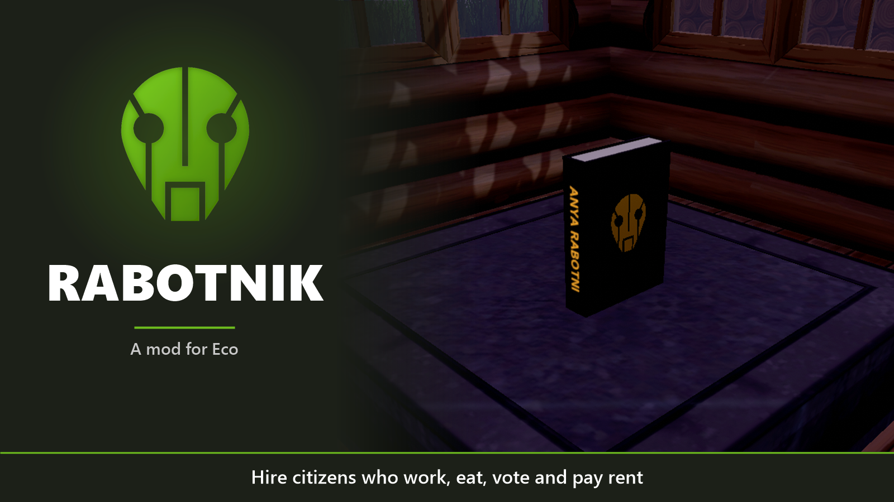
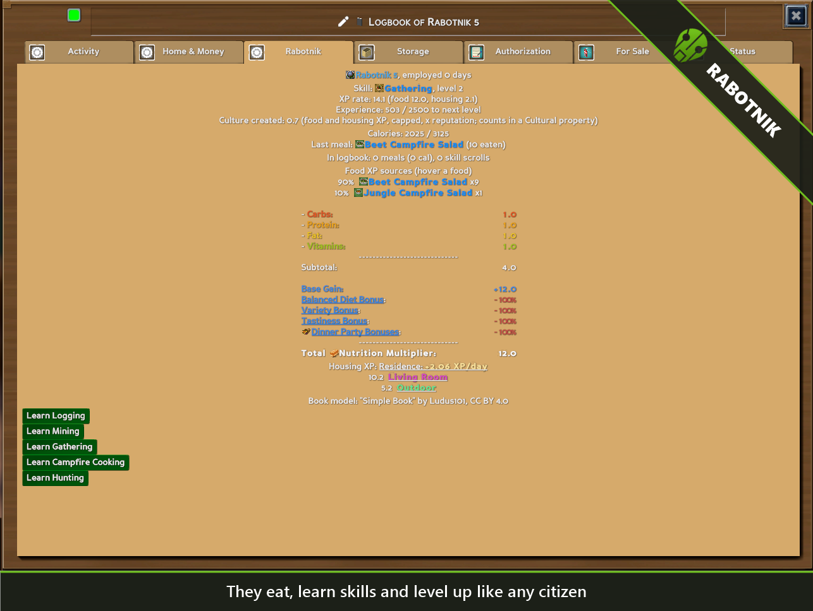
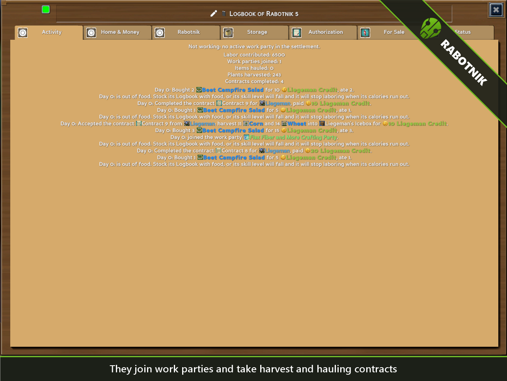
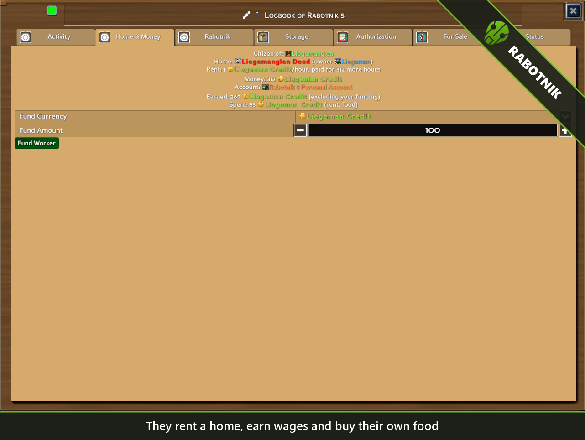
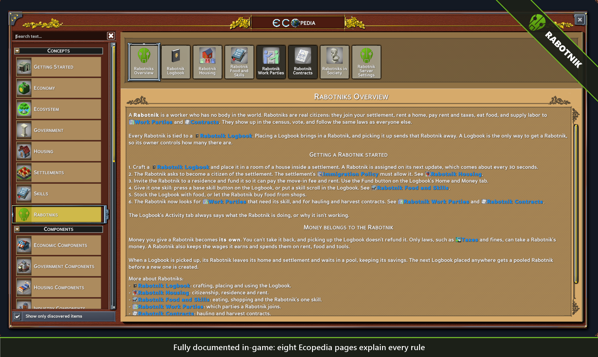
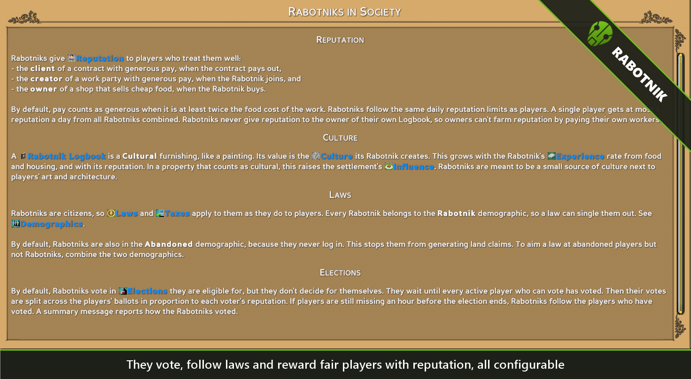
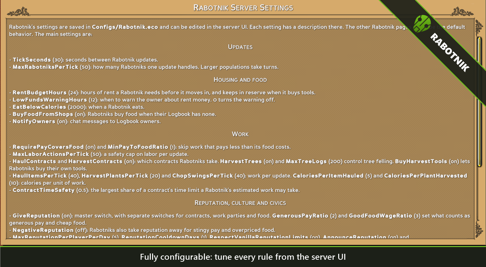

<p align="center">
  
</p>

# Rabotnik

A server mod for [Eco](https://play.eco) that adds **Rabotniks**: workers with no body in the world who are real citizens of your settlement. They rent homes, pay rent and taxes, eat food, and supply labor to work parties and contracts. They show up in the census, vote, and follow the same laws as everyone else.

Each Rabotnik is tied to a **Rabotnik Logbook**. Place a Logbook in a house to bring in a Rabotnik, and pick it up to send that Rabotnik away.

## Features

- **Real citizens.** Rabotniks immigrate through your settlement's normal immigration policy, accept residency invitations, and pay rent through the normal rent system.
- **Work parties.** A Rabotnik joins work parties that need its skill, but only when the pay covers the food the labor burns.
- **Contracts.** Rabotniks take hauling and field-harvest contracts from contract boards, including felling trees with an axe.
- **Food and skills.** Each Rabotnik learns one skill and levels it up from the labor it does. It eats food from its Logbook or buys its own from settlement shops.
- **Its own money.** A Rabotnik keeps its wages and spends them on rent, food and tools.
- **Part of society.** Rabotniks give reputation to players who pay well and sell cheap food. Their Logbooks count as cultural furnishings. Laws and taxes apply to them, and they vote in elections by following the players' ballots.
- **Documented in game.** Eight Ecopedia pages explain every rule, and the Logbook's Activity tab always says what the Rabotnik is doing, or why it isn't working.
- **Fully configurable.** Every rule can be tuned or switched off in the server UI.

## Screenshots

| | |
|:-:|:-:|
|  |  |
|  |  |
|  |  |

## Requirements

- Eco **v0.14.1.1**. Other versions may fail to compile, because Eco builds mods from source at startup.

## Installation

1. Copy the `Mods/UserCode/Rabotnik` folder into your server's `Mods/UserCode` folder.
   - Dedicated server: `<server>/Mods/UserCode/Rabotnik`
   - Single player (Steam): `Eco/Eco_Data/Server/Mods/UserCode/Rabotnik`
2. Restart the server.

Players don't need to install anything. The server sends the mod's client bundle (`rabotnik.unity3d`) to everyone who connects.

## Getting started in game

1. Craft a **Rabotnik Logbook** at a Carpentry Table (Carpentry level 1, 20 Plant Fibers and 10 Wood Boards).
2. Place it in a room of a house inside a settlement. A Rabotnik arrives on the next update, about every 30 seconds.
3. Make sure the settlement's immigration policy accepts new citizens.
4. Invite the Rabotnik to a residence. Then fund it from the Logbook's **Home and Money** tab so it can pay the move-in fee and rent.
5. Give it a skill: press a base skill button on the **Rabotnik** tab, or put a skill scroll in the Logbook.
6. Stock the Logbook with food, or let the Rabotnik buy its own from shops.
7. Post a work party or a hauling or harvest contract that pays in currency.

The in-game Ecopedia has the full rules under **Concepts > Rabotniks**.

## Configuration

Settings are saved in `Configs/Rabotnik.eco` and can be edited in the server UI, where each setting has a description. The main groups are:

| Group | Examples |
|---|---|
| Updates | `TickSeconds`, `MaxRabotniksPerTick` |
| Housing and food | `RentBudgetHours`, `EatBelowCalories`, `BuyFoodFromShops`, `NotifyOwners` |
| Work | `RequirePayCoversFood`, `HaulContracts`, `HarvestContracts`, `HarvestTrees`, `BuyHarvestTools` |
| Reputation, culture and civics | `GiveReputation`, `NegativeReputation`, `MaxReputationPerPlayerPerDay`, `CulturePerXpRate`, `RabotniksVote` |

The **Rabotnik Server Settings** Ecopedia page lists every setting with its default.

## Admin commands

| Command | What it does |
|---|---|
| `/rabotnik list` | Every Logbook, its Rabotnik and what it is doing. |
| `/rabotnik info NAME` | The full status of one Rabotnik. Part of the name is enough. |
| `/rabotnik tick` | Update every Rabotnik now. |
| `/rabotnik perf` | Time one update of every Rabotnik. |
| `/rabotnik perfspawn COUNT` | Place test Logbooks for performance testing. |
| `/rabotnik perfclear` | Remove the test Logbooks again. |

## Building from source

| Path | Contents |
|---|---|
| `Mods/UserCode/Rabotnik/` | Server C# source, Ecopedia pages and the built client bundle. |
| `Client/` | Unity 6000.3.6f1 project with the EcoModKit, used to build `rabotnik.unity3d`. |
| `tools/BuildCheck/` | A project that compiles the mod against the same references as Eco's mod compiler. |
| `images/` | The logo and the scripts that build the screenshots in this README. |

To check that the mod compiles without starting a server, install the .NET 10 SDK and run:

```sh
dotnet build tools/BuildCheck
```

To rebuild the README images on Windows:

```powershell
powershell -ExecutionPolicy Bypass -File images\annotate.ps1   # annotated screenshots
powershell -ExecutionPolicy Bypass -File images\hero.ps1       # main image
```

## Credits

- "Simple Book" model by [Ludus101](https://skfb.ly/oD6wx), licensed under [CC BY 4.0](https://creativecommons.org/licenses/by/4.0/).
- "Android mask" icon by [Lorc](https://game-icons.net/1x1/lorc/android-mask.html), licensed under [CC BY 4.0](https://creativecommons.org/licenses/by/4.0/).

[CREDITS.md](Mods/UserCode/Rabotnik/CREDITS.md) lists the changes made to each asset.

## License

Rabotnik is licensed under [Creative Commons Attribution 4.0 International (CC BY 4.0)](LICENSE). You may share and adapt it, including commercially, as long as you give credit and note any changes. The third-party assets above keep their own CC BY 4.0 licenses and attribution.

Rabotnik is a fan-made mod. It is not affiliated with or endorsed by Strange Loop Games. Eco is a trademark of Strange Loop Games.
